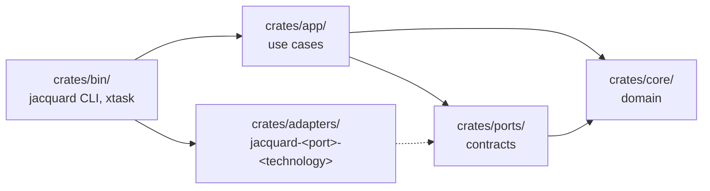

# Contributing to Jacquard

Jacquard is at the skeleton stage. The most valuable contributions are careful ones: a sharper contract, a cleaner port, a check with a negative control.

## Before You Start

1. [README](README.md): what Jacquard is for.
2. [Current state](docs/CURRENT.md): what exists, what is active, what is open.
3. [Product contract](docs/PRODUCT-CONTRACT.md): what is promised.
4. [Architecture](docs/architecture/README.md) and [ADR-0000](docs/decisions/ADR-0000-foundations.md).
5. [Glossary](docs/glossary.md): one concept, one name.

For anything bigger than a small fix, open an issue first.

## Toolchain and Checks

Rust is pinned in `rust-toolchain.toml`. Before a pull request:

```sh
cargo fmt    --all --check
cargo check  --workspace --locked --all-targets
cargo clippy --workspace --all-targets --locked -- -D warnings
cargo test   --workspace --locked
```

Then the gates, which CI runs on every push through the same command:

```sh
cargo xtask checks --profile fast --base origin/main
```

That runs the four commands above plus `check-layers`, `check-core-purity`, `check-trust-boundary` and `receipts validate`, and writes a receipt per check under `target/verification/receipts/`. Each gate prints a stable code per failure and is tested against fixtures under `tests/fixtures/`, one case or more per code ([verification/README.md](verification/README.md)).

## Where Code Goes



Dependencies point inward. `core/` depends on nothing. `app/` never depends on `adapters/`. Only `bin/` wires adapters to ports. A new technology is a new adapter crate; it never adds a dependency to the core.

## How Work Is Judged

Most code here is written by language models and reviewed by people. A model's verdict is never a gate ([ADR-0001](docs/decisions/ADR-0001-accept-work-on-executable-evidence.md)). What gates is a registered Check with a Receipt. The specification and the verifier are protected; a change to them is declared in its own commit with a `Trust-Boundary:` line ([AGENTS.md](AGENTS.md) rule 10). A test written alongside the code it tests is a regression test; a test whose oracle comes from outside the code is evidence for a property.

## Documentation

Direct, compact, skeptical prose built on mechanisms. American spelling, Title Case headings, Oxford comma. Mermaid diagrams only, with no labels on arrows. Decisions go in `docs/decisions/` with Status, Date, Context, Decision, Consequences and Validation. Research snapshots under `docs/research/` are dated, cite their sources, and are never edited; a revision is a new snapshot.

## Commits, Branches, Pull Requests

- One change per pull request. Oracle changes in their own commits, declared.
- Imperative subject, the *why* in the body.
- `milestone/<nn>-<name>` branches, named from `docs/CURRENT.md`.
- CI is green before review. Merge with merge commits.

## License

Not yet chosen; see the open decisions in [docs/CURRENT.md](docs/CURRENT.md).
