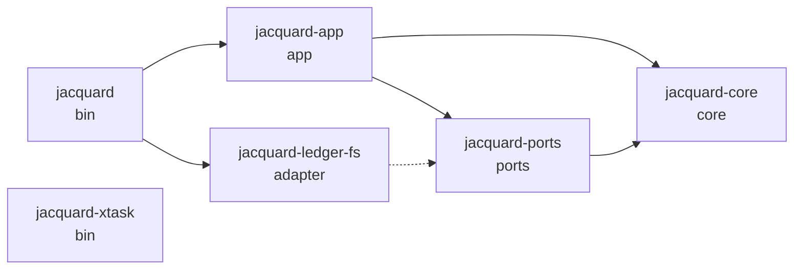

# Hexagon

Domain semantics point inward; effects point outward ([ADR-0000](../decisions/ADR-0000-foundations.md)).

| Layer | Crates | May depend on | Holds |
| --- | --- | --- | --- |
| core | `jacquard-core` | nothing | Draft, Swatch, Outcome, Judgment, Vote, ranking kernels; `no_std`, pure |
| ports | `jacquard-ports` | core | Loom, Renderer, Checker, Judge, Ledger traits |
| app | `jacquard-app` | core, ports | the cascade as use cases |
| adapters | `jacquard-ledger-fs`, later `jacquard-loom-anthropic`, `jacquard-judge-anthropic`, `jacquard-renderer-playwright`, `jacquard-checker-process`, `jacquard-judge-local` | core and one port | technology |
| bin | `jacquard`, `jacquard-xtask` | anything | composition root; repository tooling |

Dev, build and target-specific dependencies get no exemption. Nothing depends on a `bin/` crate. A new crate needs a layer in `layers.json`; an exception needs a written reason in an ADR.
