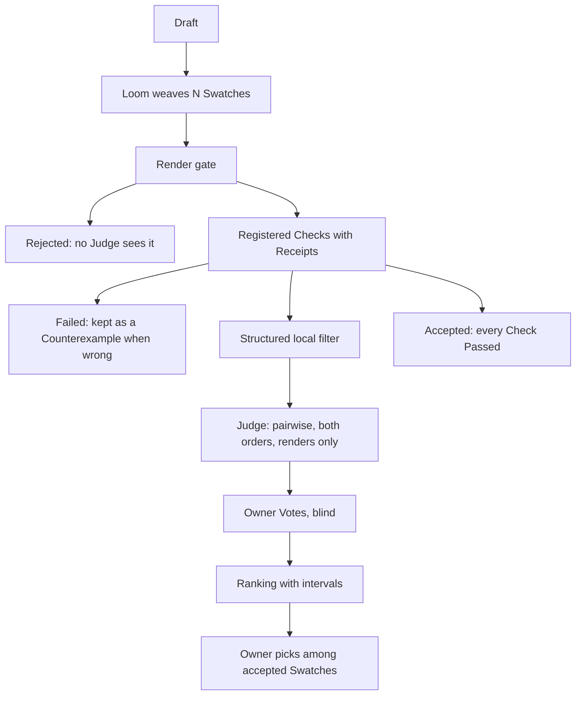

# The Loop

From a Draft to an accepted Swatch. Each tier is cheaper than the next; only survivors move on; every tier writes to the Ledger.

| Tier | Gates? | Record |
| --- | --- | --- |
| Render gate | yes | Receipt |
| Checks | yes | Receipt per Check |
| Structured local filter | no; a filter with a measured false-positive rate | Receipt with the question and answer |
| Judge | no | Judgment per presentation order |
| Votes | no | Vote |
| Ranking | no | the estimate and its intervals |

Acceptance is decided by the two gating tiers. The Judge and the Votes decide which accepted Swatch the owner sees first. A Judge is admitted by a known-answer set and re-admitted on any change ([contract clause 5](../PRODUCT-CONTRACT.md)).

The evidence for this shape is in the [research digest](../research/2026-09-28-design-loops/README.md): separate critics on rendered evidence beat self-revision; order swap alone moves verdicts by more than ten percent; a trace claiming success makes judges accept visibly failed output; compile-and-render filters before any judge multiplied usable candidates.
